# Sistema de Control de Evaluaciones de Centros de Manejo

## Información del Estudiante

**Nombre:** Allan Josué Rafael Morales 
**Carnet:** 201709196  
**Curso:** Base de Datos 1 - Sección B  
**Semestre:** Segundo Semestre 2025  
**Universidad:** Universidad de San Carlos de Guatemala  
**Facultad:** Facultad de Ingeniería  
**Proyecto:** Fase 2 - Sistema de Evaluaciones

---

## Descripción del Proyecto

Sistema de gestión de evaluaciones para centros de manejo que implementa una base de datos Oracle XE containerizada con Docker y una API REST desarrollada en Node.js con Express.

### Objetivos

- Gestionar información de personas evaluadas (registro de candidatos)
- Administrar centros de evaluación y escuelas de manejo
- Controlar exámenes teóricos y prácticos
- Generar reportes y estadísticas de aprobación
- Analizar preguntas con mayor dificultad
- Crear ranking de evaluados por desempeño

### Modelo de Datos

El sistema maneja las siguientes entidades principales:

- **DEPARTAMENTO**: Divisiones administrativas a nivel de departamento (Guatemala, Sacatepéquez, Escuintla, etc.)
- **MUNICIPIO**: Municipios pertenecientes a cada departamento
- **CENTRO**: Centros de evaluación donde se realizan los exámenes
- **ESCUELA**: Escuelas de manejo autorizadas
- **UBICACION**: Relación N:M entre escuelas y centros (una escuela puede evaluar en múltiples centros)
- **REGISTRO**: Personas registradas para evaluación con sus datos personales
- **CORRELATIVO**: Control de correlativos de exámenes por fecha
- **EXAMEN**: Exámenes realizados vinculando registro y correlativo
- **PREGUNTAS**: Banco de preguntas teóricas con opciones múltiples
- **PREGUNTAS_PRACTICO**: Banco de preguntas prácticas con puntaje asignado
- **RESPUESTA_USUARIO**: Respuestas de evaluados a preguntas teóricas
- **RESPUESTA_PRACTICO_USUARIO**: Calificaciones de evaluados en preguntas prácticas

---

## Tecnologías Utilizadas

### Backend
- Node.js v18+
- Express.js v5.1.0
- oracledb v6.9.0
- dotenv v17.2.3

### Base de Datos
- Oracle Database XE 18c
- Docker (gvenzl/oracle-xe:18.4.0-slim)

### Herramientas
- Nodemon v3.1.10
- Postman
- DBeaver
- Git

---

## Despliegue del Sistema

### Prerrequisitos

- Docker Desktop (versión 20.10 o superior)
- Node.js (versión 18 o superior)
- npm (versión 9 o superior)
- Git
- Postman (para probar endpoints)
- DBeaver (cliente SQL)

### Paso 1: Clonar el Repositorio

```bash
git clone <URL_DEL_REPOSITORIO>
cd Proyecto2_201709196
```

### Paso 2: Desplegar Base de Datos con Docker

#### Iniciar contenedor Oracle

```bash
# Levantar el contenedor
docker-compose up -d

# Verificar que esté corriendo
docker ps

# Ver logs de inicialización (esperar 2-5 minutos)
docker logs -f oracle-xe
```

Esperar hasta ver el mensaje: `DATABASE IS READY TO USE!`

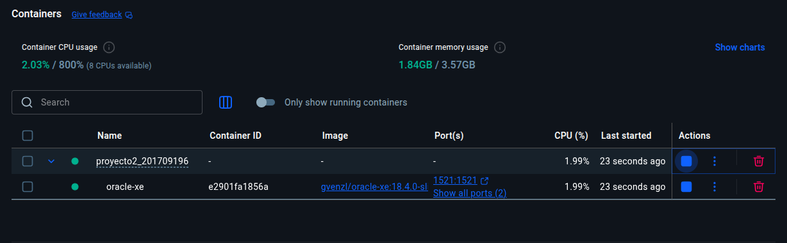
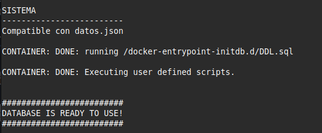

### Paso 3: Configurar e Iniciar API

#### Instalar dependencias

```bash
cd API
npm install
```

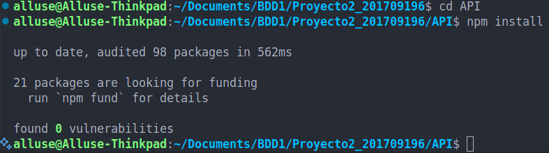

#### Configurar variables de entorno

Crear archivo `.env` en el directorio `API/`:

```env
# Configuración de Base de Datos Oracle
DB_USER=system
DB_PASSWORD=Gusano15.
DB_CONNECTION_STRING=localhost:1521/XEPDB1

# Configuración del servidor
PORT=3000
NODE_ENV=development
```

#### Iniciar servidor

```bash
# Modo desarrollo (con auto-reload)
npm run dev

# O modo producción
npm start
```

El servidor iniciará en `http://localhost:3000`

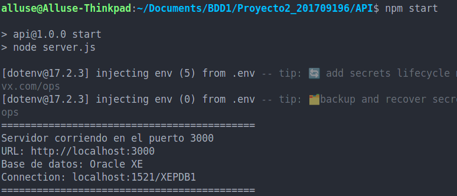

#### Verificar API

Visitar `http://localhost:3000` para ver información de la API.

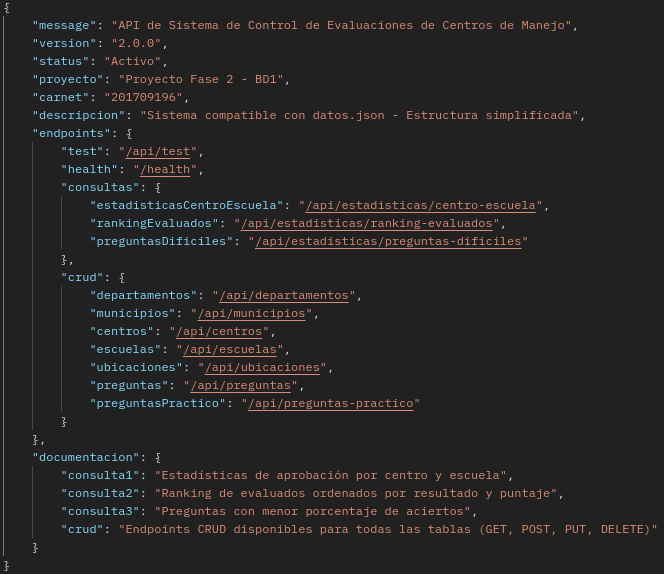

Probar endpoint de test:

```bash
curl http://localhost:3000/api/test
```

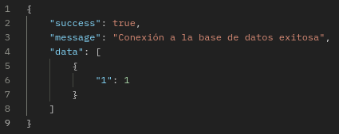

---

## Guía de Configuración con DBeaver

### Instalación

1. Descargar DBeaver Community desde: https://dbeaver.io/download/
2. Instalar según sistema operativo
3. Abrir DBeaver

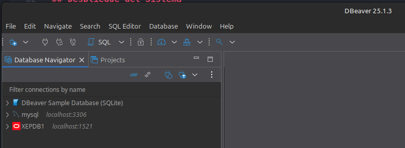

### Crear Conexión a Oracle

#### Paso 1: Nuevo asistente de conexión

1. Click en "Database" → "New Database Connection"
2. Seleccionar "Oracle"
3. Click en "Next"

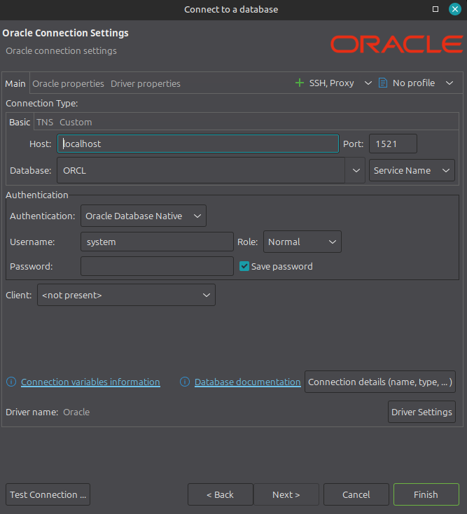

#### Paso 2: Configurar parámetros

| Campo | Valor |
|-------|-------|
| Host | `localhost` |
| Port | `1521` |
| Database | `XEPDB1` |
| Username | `system` |
| Password | `Gusano15.` |


#### Paso 3: Descargar driver (si es necesario)

DBeaver descargará automáticamente el driver JDBC de Oracle.


#### Paso 4: Probar conexión

1. Click en "Test Connection"
2. Verificar mensaje "Connected"
3. Click en "Finish"

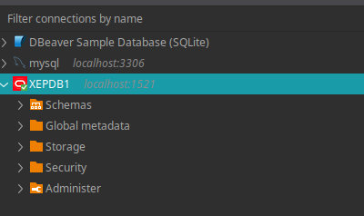

### Explorar Base de Datos

#### Ver tablas

Navegar a: **XEPDB1** → **Schemas** → **SYSTEM** → **Tables**

Tablas disponibles:
- DEPARTAMENTO
- MUNICIPIO
- CENTRO
- ESCUELA
- UBICACION
- REGISTRO
- CORRELATIVO
- EXAMEN
- PREGUNTAS
- PREGUNTAS_PRACTICO
- RESPUESTA_USUARIO
- RESPUESTA_PRACTICO_USUARIO

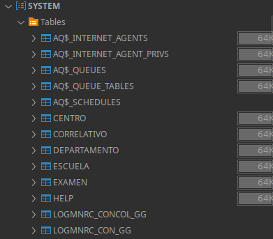

#### Ver datos de una tabla

Click derecho sobre tabla → "View Data" → "View All Rows"

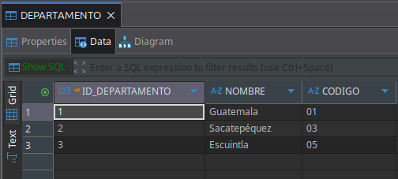


#### Diagrama ER

Click derecho en schema **SYSTEM** → "View Diagram"

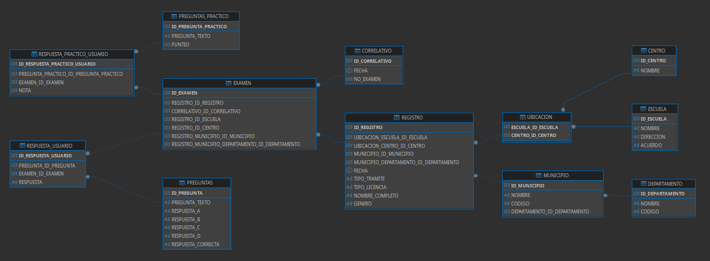

---

## Uso de Endpoints de la API

### Base URL

```
http://localhost:3000
```

### Endpoints de Salud

#### GET /

Información general de la API

```http
GET http://localhost:3000/
```

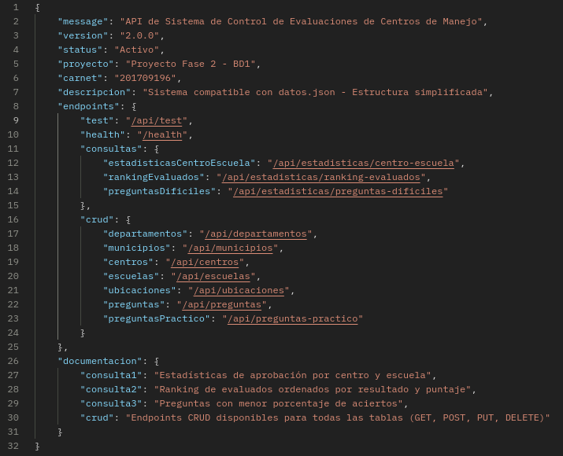

#### GET /health
 
Estado del servidor

```http
GET http://localhost:3000/health
```
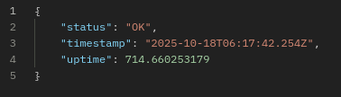

#### GET /api/test

Prueba de conexión a base de datos

```http
GET http://localhost:3000/api/test
```

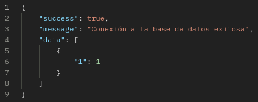

---

## Consultas y Estadísticas

### Consulta 1: Estadísticas por Centro y Escuela

Estadísticas de aprobación agrupadas por centro y escuela.

```http
GET /api/estadisticas/centro-escuela
```

**Parámetros query opcionales:**
- `centro`: Filtrar por nombre de centro
- `escuela`: Filtrar por nombre de escuela
- `limit`: Limitar cantidad de resultados

**Ejemplo:**
```http
GET http://localhost:3000/api/estadisticas/centro-escuela?limit=5
```

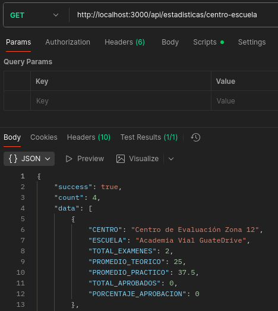

### Consulta 2: Ranking de Evaluados

Ranking de personas evaluadas ordenadas por resultado y puntaje.

```http
GET /api/estadisticas/ranking-evaluados
```

**Parámetros query opcionales:**
- `resultado`: `APROBADO` o `REPROBADO`
- `tipo_licencia`: Tipo de licencia
- `genero`: `M` o `F`
- `municipio`: Nombre del municipio
- `limit`: Limitar resultados

**Ejemplo:**
```http
GET http://localhost:3000/api/estadisticas/ranking-evaluados?resultado=APROBADO&limit=10
```

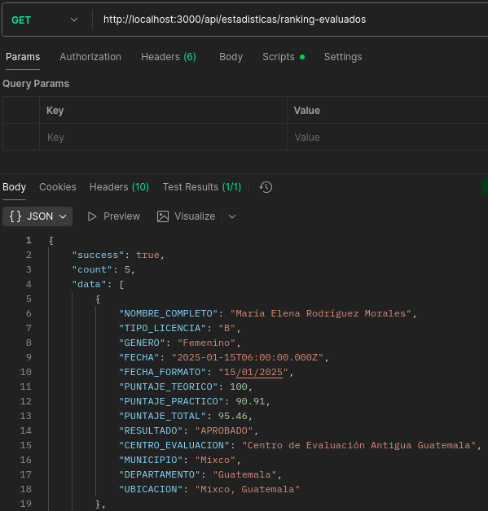

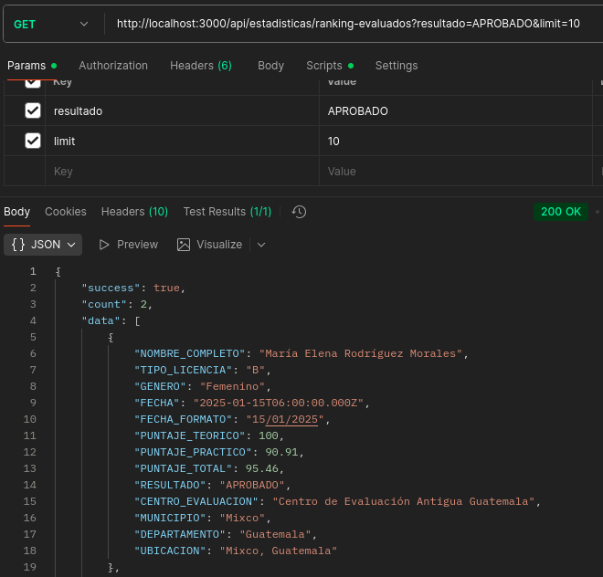

### Consulta 3: Preguntas Difíciles

Preguntas con menor porcentaje de respuestas correctas.

```http
GET /api/estadisticas/preguntas-dificiles?limit=5
```


---

## Endpoints CRUD

### CRUD - Departamentos

```http
GET    /api/departamentos           # Listar todos
GET    /api/departamentos/:id       # Obtener por ID
POST   /api/departamentos           # Crear nuevo
PUT    /api/departamentos/:id       # Actualizar
DELETE /api/departamentos/:id       # Eliminar
```

**Ejemplo POST:**
```json
{
  "nombre": "Alta Verapaz",
  "codigo": "16"
}
```

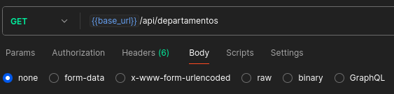

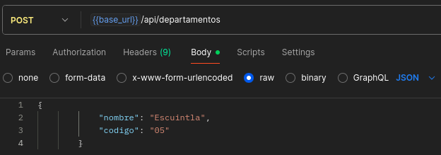

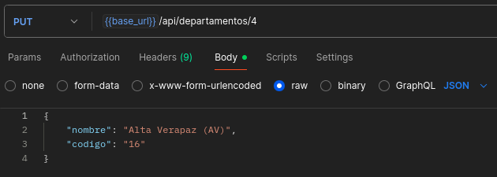

### CRUD - Municipios

```http
GET    /api/municipios                          # Listar todos
GET    /api/municipios/:id                      # Obtener por ID
GET    /api/departamentos/:id/municipios        # Por departamento
POST   /api/municipios                          # Crear nuevo
PUT    /api/municipios/:id                      # Actualizar
DELETE /api/municipios/:id                      # Eliminar
```

**Ejemplo POST:**
```json
{
  "nombre": "San Juan Sacatepéquez",
  "codigo": "09",
  "departamento_id_departamento": 1
}
```

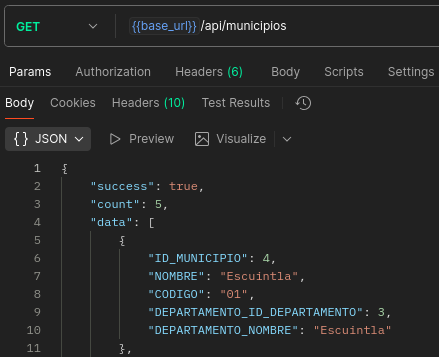

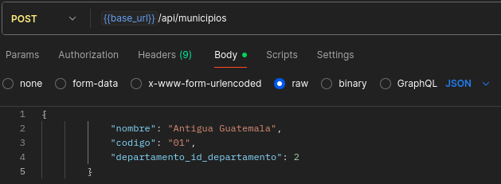

### CRUD - Centros

```http
GET    /api/centros           # Listar todos
GET    /api/centros/:id       # Obtener por ID
POST   /api/centros           # Crear nuevo
PUT    /api/centros/:id       # Actualizar
DELETE /api/centros/:id       # Eliminar
```

**Ejemplo POST:**
```json
{
  "nombre": "Centro de Evaluación Zona 1"
}
```

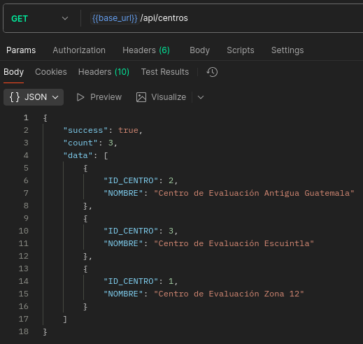

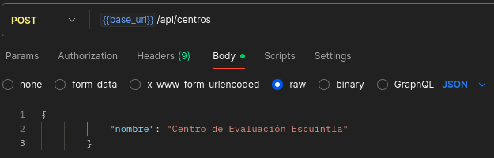

### CRUD - Escuelas

```http
GET    /api/escuelas           # Listar todos
GET    /api/escuelas/:id       # Obtener por ID
POST   /api/escuelas           # Crear nuevo
PUT    /api/escuelas/:id       # Actualizar
DELETE /api/escuelas/:id       # Eliminar
```

**Ejemplo POST:**
```json
{
  "nombre": "Escuela Elite Drive",
  "direccion": "Calzada San Juan 25-30, Zona 7",
  "acuerdo": "ESC-ED-004"
}
```

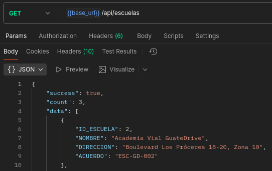

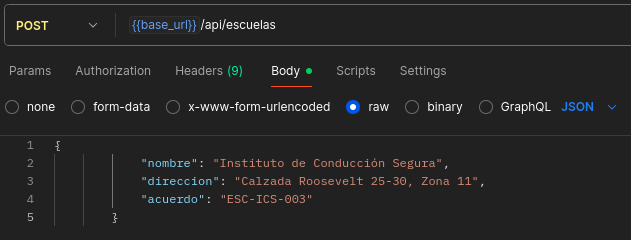

### CRUD - Ubicaciones

```http
GET    /api/ubicaciones                          # Listar todas
GET    /api/ubicaciones/:id_escuela/:id_centro   # Obtener específica
POST   /api/ubicaciones                          # Crear nueva
DELETE /api/ubicaciones/:id_escuela/:id_centro   # Eliminar
```

**Ejemplo POST:**
```json
{
  "escuela_id_escuela": 1,
  "centro_id_centro": 3
}
```

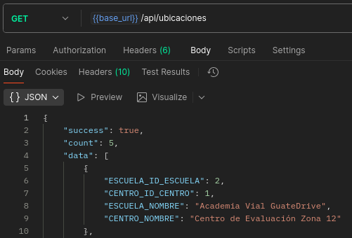

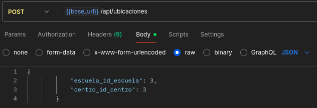

### CRUD - Preguntas Teóricas

```http
GET    /api/preguntas           # Listar todas
GET    /api/preguntas/:id       # Obtener por ID
POST   /api/preguntas           # Crear nueva
PUT    /api/preguntas/:id       # Actualizar
DELETE /api/preguntas/:id       # Eliminar
```

**Ejemplo POST:**
```json
{
  "pregunta": "¿Qué significa una luz amarilla en el semáforo?",
  "respuesta_a": "Detenerse inmediatamente",
  "respuesta_b": "Acelerar para pasar",
  "respuesta_c": "Precaución, prepare para detenerse",
  "respuesta_d": "Continuar sin cambios",
  "respuesta_correcta": "C"
}
```

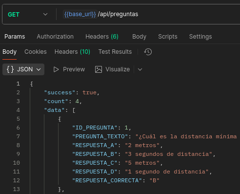

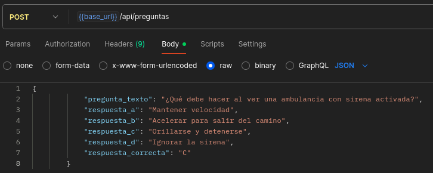

### CRUD - Preguntas Prácticas

```http
GET    /api/preguntas-practico           # Listar todas
GET    /api/preguntas-practico/:id       # Obtener por ID
POST   /api/preguntas-practico           # Crear nueva
PUT    /api/preguntas-practico/:id       # Actualizar
DELETE /api/preguntas-practico/:id       # Eliminar
```

**Ejemplo POST:**
```json
{
  "descripcion": "Cambio de carril en autopista",
  "punteo": 18
}
```

**[CAPTURA 38: Lista de preguntas prácticas]**
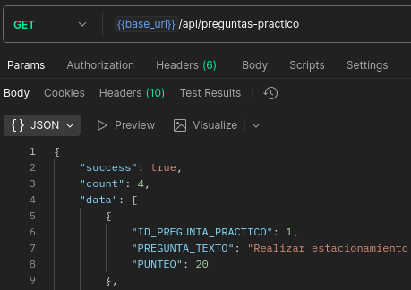

**[CAPTURA 39: Crear pregunta práctica]**
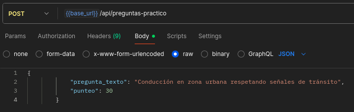

---

## Colección de Postman

### Importar Colección

1. Abrir Postman
2. Click en "Import"
3. Seleccionar archivo: `API/Postman_Collection.json`

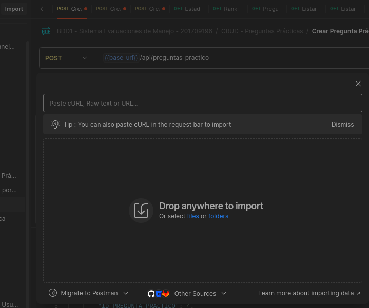

### Configurar Environment

Crear environment con variables:

| Variable | Valor |
|----------|-------|
| `base_url` | `http://localhost:3000` |
| `api_url` | `{{base_url}}/api` |


### Estructura de la Colección

- Health & Test
- Consultas (Estadísticas)
- CRUD - Departamento
- CRUD - Municipio
- CRUD - Centro
- CRUD - Escuela
- CRUD - Ubicacion
- CRUD - Preguntas
- CRUD - Preguntas Práctico

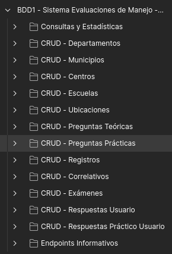

---

## Estructura del Proyecto

```
Proyecto2_201709196/
│
├── API/
│   ├── config/
│   │   └── database.js
│   ├── controllers/
│   │   ├── consultasController.js
│   │   └── mainController.js
│   ├── routes/
│   │   ├── consultas.routes.js
│   │   └── main.routes.js
│   ├── .env
│   ├── package.json
│   ├── server.js
│   └── Postman_Collection.json
│
├── DDL.sql
├── vistas.sql
├── datos.json
├── docker-compose.yml
├── Proyecto_Fase2.pdf
└── README.md
```

---

## Solución de Problemas

### Error: ORA-12541 (TNS:no listener)

**Causa:** No se puede conectar a Oracle.

**Solución:**
```bash
docker ps                    # Verificar contenedor
docker logs oracle-xe        # Ver logs
# Esperar 2-5 minutos para inicialización completa
```

### Error: ORA-00942 (table or view does not exist)

**Causa:** Tablas no existen en base de datos.

**Solución:**
```bash
docker cp DDL.sql oracle-xe:/opt/oracle/
docker exec -it oracle-xe bash -c "sqlplus system/Gusano15.@localhost:1521/XEPDB1 @/opt/oracle/DDL.sql"
```

### Error: Cannot find module

**Causa:** Dependencias no instaladas.

**Solución:**
```bash
cd API
npm install
```

### Error: Port already in use

**Causa:** Puerto 3000 ocupado.

**Solución:**
Cambiar puerto en archivo `.env`: `PORT=3001`

---

## Configuración de Seguridad

### Archivo .env

```env
DB_USER=system
DB_PASSWORD=Gusano15.
DB_CONNECTION_STRING=localhost:1521/XEPDB1
PORT=3000
NODE_ENV=development
```

### .gitignore

```gitignore
node_modules/
.env
.env.local
*.log
.DS_Store
.vscode/
```

---


## Referencias

- [Oracle Database Documentation](https://docs.oracle.com/en/database/)
- [Node.js Documentation](https://nodejs.org/docs/)
- [Express.js Documentation](https://expressjs.com/)
- [node-oracledb Documentation](https://node-oracledb.readthedocs.io/)
- [Docker Documentation](https://docs.docker.com/)
- [DBeaver Documentation](https://dbeaver.io/docs/)

---